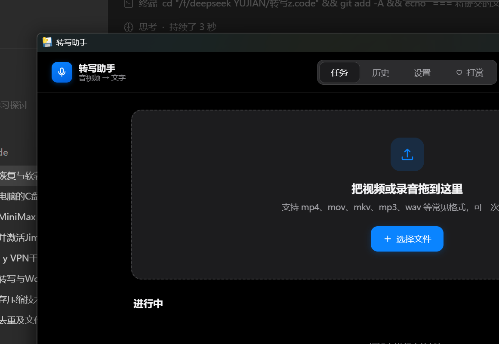

# 转写助手 · 项目说明

> 一个从零做起的本地 AI 转写软件。独立完成需求定义、技术选型、工程实现、打包分发与著作权登记。

- **项目周期**：2026-08-22 ~ 2026-10-23（约两个月，业余时间）
- **角色**：独立开发者（产品定义 + 全部实现 + 测试验收）
- **代码量**：4,261 行（Python / JavaScript / HTML / CSS），19 个文件
- **当前状态**：Windows 安装包已发布，手机端 PWA 已上线；软件著作权已提交受理

---

## 一、项目要解决的问题

我平时要处理大量音视频资料：网课录屏、访谈录音、会议记录。

现成的方案都有痛点：

| 方案 | 问题 |
|---|---|
| 在线转写网站 | 按分钟收费，长录音成本高；内容上传第三方，隐私无保障 |
| 剪映/飞书等自带转写 | 只能在各自生态里用，导出格式死板，无法自定义 |
| 开源 Whisper 命令行 | 要装 Python、配环境、敲命令，非技术用户用不了 |

所以目标很明确：**做一个普通人双击就能用、完全离线、免费、输出可直接交付的 Word 文档的工具。**

三条产品原则，按优先级排序：

1. **识别准确** > 2. **使用简单** > 3. **节省费用**

---

## 二、做了什么

### 界面



深色模式下主界面：顶部是品牌区与四个页签（任务 / 历史 / 设置 / 打赏），中间是拖放区，
下方是任务队列。整套 UI 用原生 HTML/CSS 手写，无前端框架，支持浅色/深色/跟随系统三种主题。

### 桌面版（Windows）

一首歌的时间就能把一个视频变成可交付的文字资料。

| 能力 | 说明 |
|---|---|
| 本地识别 | 内置 Whisper large-v3（2.9 GB），完全离线，不联网也能跑 |
| 硬件自适应 | 自动检测显存/内存/核数，选模型档位；有独显用 GPU，没有就降档保可用 |
| 热词注入 | 用户可配置人名、专业术语，显著降低专有名词错字 |
| AI 校对 | 分块送大模型改错别字、补标点、统一术语，可开关 |
| 自动总结 | 生成摘要、核心要点、内容详解、行动项 |
| 存疑标注 | 识别置信度低的片段自动打 `[存疑]`，文末汇总，点一下就能试听原声核对 |
| 标准化输出 | 每个视频一个文件夹：`文字记录.docx` + `总结提炼.docx` + `音频.mp3` + `.srt` |
| 任务队列 | 批量拖入、断点续跑、失败重试、运行中可取消 |
| 隐私开关 | 可选择"转写完就删掉源视频和音频"，只留文档 |

### 手机版（PWA）

电脑跑不动的地方，手机端换了一条技术路线：录音或选文件后，直接调用户自己配置的语音识别 API，即时出文字。支持 iPhone 和安卓，加到主屏幕就能当 App 用。

---

## 三、技术方案

### 架构

```
┌─────────────────────────────────────┐
│ 前端（原生 HTML/CSS/JS，无框架）        │
│ 任务 / 历史 / 设置 / 打赏              │
└──────────────┬──────────────────────┘
               │ 本地 HTTP（带一次性令牌）
┌──────────────▼──────────────────────┐
│ Flask 服务层                          │
│ 任务 API / 设置 / 上传 / 试听 / 打开位置 │
├─────────────────────────────────────┤
│ 任务调度（单线程队列 + 状态落盘）        │
│ 断点续跑 · 阶段缓存 · 中途取消           │
├─────────────────────────────────────┤
│ 能力层                                │
│ engine.py    音频提取 / 模型档位 / 识别  │
│ proofread.py 分块校对 / 分段总结        │
│ docgen.py    Word 与字幕生成           │
│ config.py    配置 + 密钥加密           │
│ paths.py     程序目录与数据目录分离      │
└─────────────────────────────────────┘
```

### 技术栈

| 层 | 选型 | 为什么 |
|---|---|---|
| 窗口 | pywebview + WebView2 | 网页级界面质量，又是真原生窗口，不依赖浏览器 |
| 后端 | Python 3.12 + Flask | 生态最全，识别链路成熟 |
| 识别 | faster-whisper（CTranslate2 后端） | 比原版 Whisper 快 4 倍，CPU 也能跑 |
| 文档 | python-docx | 精确控制 Word 样式、页码、表格 |
| 音视频 | ffmpeg（随包分发） | 格式兼容性最好 |
| 打包 | PyInstaller + Inno Setup | 一键安装包，用户零配置 |
| 手机端 | 原生 JS + PWA | 一套代码跑 iOS/Android，无需上架 |

---

## 四、真正难的地方

这部分是我认为项目里最有价值的部分——不是"实现了什么"，而是"踩了什么坑、怎么爬出来的"。

### 1. 大模型把长文稿"吃掉了一半"

**现象**：47 分钟的访谈转写稿送去做 AI 校对，回来的文本明显短了，后半段凭空消失。

**原因**：大模型单次输出有 token 上限（约 8k），长文稿被截断。更麻烦的是，它会"自作聪明"合并相邻的句子。

**解决**：
- **分块校对**：把文稿按 4,000 字符切块，逐块送校对
- **时间戳锚点合并**：校对稿和原文靠 `[MM:SS]` 时间戳逐行对齐；校对稿缺哪行，就用原文补回哪行

结果：一行不丢，即使某一块校对失败也只回退该块的原文，不中断整个流程。

### 2. CUDA 库打不进安装包

**现象**：开发环境跑得好好的，PyInstaller 打包后一启动就报找不到 `cublas64_12.dll`。

**原因**：NVIDIA 的运行时库不在 Python 默认搜索路径里，且必须在导入 CTranslate2 **之前**就注册好。

**解决**：在模块导入阶段就扫描 `nvidia/*/bin` 目录，同时写进 `os.add_dll_directory()` 和 `PATH`，覆盖源码环境和 PyInstaller 解包环境两种场景。

### 3. 用户数据把程序目录撑爆了

**现象**：第一次打包上线后，软件目录涨到 9 GB。用户如果把程序装到 `C:\Program Files`，直接因为无写权限崩溃。

**原因**：把"数据目录"和"程序目录"当成了一个东西。

**解决**：拆分两套路径——程序目录只读（放前端、模型、ffmpeg），数据目录写在 `%LOCALAPPDATA%`。同时做了兼容迁移：老用户目录里已有数据就原地不动，不让人找不到文件。

### 4. API Key 明文躺在配置文件里

**问题**：用户把装好的文件夹发给别人，DeepSeek Key 就跟着走了。

**解决**：用 Windows DPAPI 按当前用户身份加密密钥。拷到别的电脑解不开，软件会自动当成"未配置"，让用户重填，不会报错崩溃。

### 5. 长视频的总结超出上下文

**问题**：3 小时录音的转写稿远超模型上下文窗口。

**解决**：map-reduce 两段式——先分段提炼要点，再把要点合并成结构化总结。短文稿走直通路径，不多花一次调用。

### 6. 运行中的任务取消不了

**问题**：界面有取消按钮，点了没反应。因为队列只在"取任务"时检查取消标志，任务跑起来后就没人看这个标志了。

**解决**：把取消检查下沉到进度回调和 ffmpeg 子进程等待循环里，取消时直接 kill 子进程。

---

## 五、成果

| 指标 | 数据 |
|---|---|
| 真实数据验证 | 47 分钟访谈视频端到端跑通 |
| 输出完整度 | 每视频 4 份产物（2 Word + 音频 + 字幕） |
| 安装包 | 3.3 GB（含离线模型），一键安装，无需管理员权限 |
| 单文件依赖 | 用户零配置，不需要装 Python、ffmpeg 或任何运行库 |
| 软件著作权 | 已提交中国版权保护中心，受理号 2026R11L3085396 |

---

## 六、这个项目让我学到什么

- **产品取舍比技术堆砌难**。中间砍掉过"说话人区分"功能——它技术上能跑通，但要额外打包 3 GB 的 PyTorch 依赖，且实际使用中准确率不稳定。权衡之后删掉，安装包从 7 GB 降到 3.3 GB，换来更好的安装体验。
- **"能跑"和"能交付"之间隔着包装、日志、错误恢复、数据迁移**。写功能只占三分之一工作量。
- **错误恢复的设计要提前**。断点续跑的阶段缓存一开始没做，47 分钟视频因为最后一步失败重跑一遍，才发现必须把识别结果先落盘。
- **不做假设**。我以为老数据的字段格式不会变，结果加入时间排序时，新旧任务的 `created` 字段一个是字符串一个是浮点数，接口直接 500。上线前加迁移就有了。

---

## 七、后续计划

- 接入更多云端识别服务商（当前支持硅基流动、OpenAI 及所有 OpenAI 兼容接口）
- 实时转写（边录边出字）
- macOS 版本（需要 macOS 构建环境）

---

*项目代码：https://github.com/Danshiduzhi/zhuanxie-zhushou*
